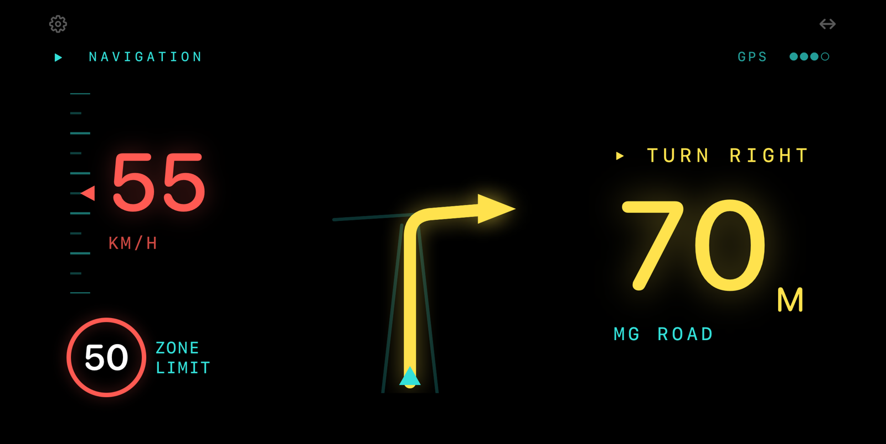
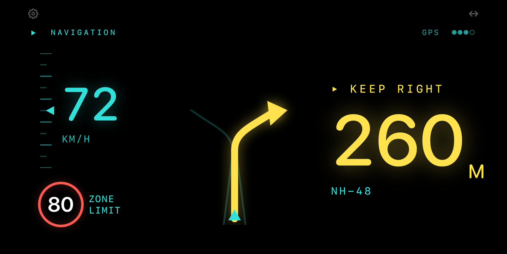
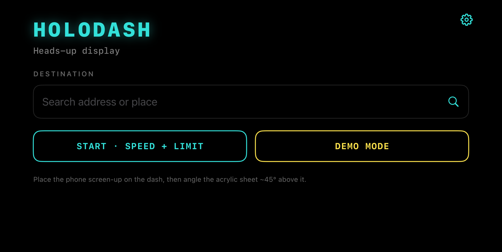

# HoloDash

<!-- HERO: photo of the rig on the dashboard at dusk — Rishabh to add docs/images/hero.jpg -->

A heads-up display for my car, made from an iPhone and a sheet of acrylic.



| Keeping right on a highway | The setup screen |
|---|---|
|  |  |

<sub>Simulator screenshots in demo mode, not mirrored.</sub>

## How it works

It is the old trick behind car HUDs, Pepper's ghost.

1. The phone lies flat on the dashboard, screen up.
2. A sheet of acrylic stands over it at an angle.
3. The screen reflects off the acrylic, so the image seems to float over the road.
4. The reflection is flipped, so the app draws everything mirrored. You can switch the mirroring off.

Bare acrylic reflects only 5 to 10 percent of a screen's light. So the design has to earn every pixel: few elements, high contrast, a white outline and a coloured glow. I tested the optics with mock HUDs before I wrote any app code. Those test pages are in `design/`.

## What it does

- **Next turn:** drawn as a road diagram with the distance to it. There are 13 junction types, including roundabouts and forks.
- **Directions:** turn-by-turn from Apple Maps, with no API key. You search for the destination inside the app.
- **Speed:** live from GPS. It turns red past the limit, with a margin you set.
- **Speed limit:** comes from OpenStreetMap and shows as a road-sign roundel. It shows "--" where the map has no data.
- **GPS signal:** the small indicator at the top is driven by the GPS horizontal accuracy.
- **Speed-only mode:** for drives that don't need directions.
- **Mirrored image:** so it reads the right way round in the reflection.
- **Settings:** km/h or mph (speed, limit and turn distances), over-limit margin, mirroring, keep the screen awake, larger text. It respects Reduce Motion.
- **Demo mode:** cycles through every kind of turn, so you can try it off the road.

## What's in the repo

- `Sources/` — the SwiftUI app: HUD, road diagrams, navigation, speed limit lookup, settings.
- `project.yml` — the [XcodeGen](https://github.com/yonaskolb/XcodeGen) spec. The Xcode project is generated from it and is not committed.
- `design/` — the optics test page (`holodash-optics-test.html`) and the refined HUD mockup (`holodash-hud-refined.html`). Open them in a browser.
- `docs/images/` — images for this README.

## How to try it

### In the Simulator (no car, no rig)

```bash
brew install xcodegen
xcodegen generate
open HoloDash.xcodeproj
```

Pick an iPhone simulator, then add these launch arguments in the scheme (Edit Scheme, Run, Arguments):

- `-demoMode` starts straight into the HUD and cycles through every turn.
- `-noMirror` turns off the mirroring for that run, so it reads normally on a screen. Without it, mirroring is on (or whatever you last chose in Settings).

The app is landscape only.

### On a phone

1. Run `xcodegen generate` and open `HoloDash.xcodeproj`.
2. In the HoloDash target, Signing & Capabilities, choose your own team.
3. Change the bundle identifier (`com.rishabh.holodash`) to one of your own. Do the same in `project.yml` if you regenerate.
4. Build to your iPhone. You need iOS 17 or later.

## What isn't done

- Rerouting. If you miss a turn, it does not recalculate.
- Maneuver types are read from the English text of Apple's instructions, so it only works with English directions.
- There are no tests.

## A note on safety

Don't fiddle with it while driving. Set it up before you move. Check the laws where you drive, because rules on screens and devices in a car differ from place to place. This is a personal project, not a navigation product, and it can be wrong.

## Credits

Speed limits come from OpenStreetMap data, queried through the Overpass API. © OpenStreetMap contributors, available under the [Open Database Licence](https://www.openstreetmap.org/copyright). Directions come from Apple MapKit.

---

Shared to show the work. All rights reserved. Please ask before reusing any of it.
